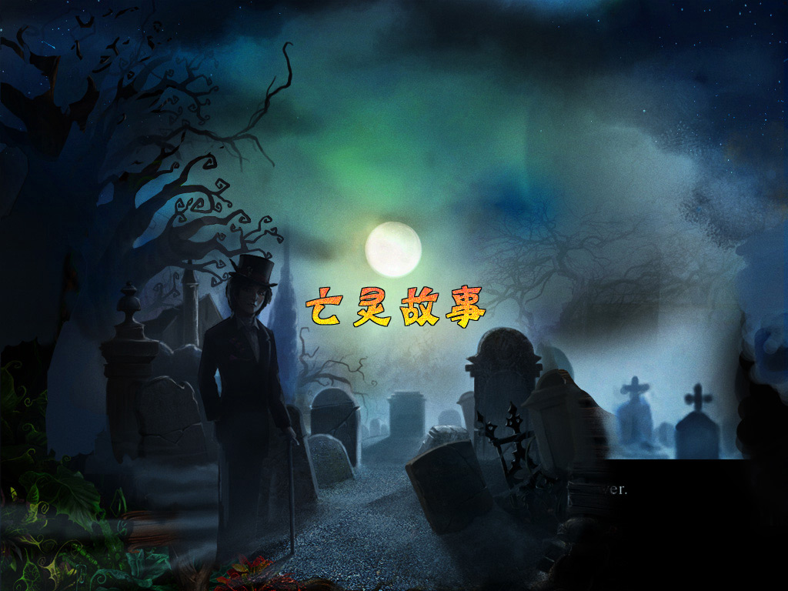

# Deadtime Stories · 亡灵故事



## 再次走进幽灵的世界

在阴影笼罩的宅院、墓园与沼泽中寻找物品，收集配方，调制药剂，解开亡灵留下的谜题。《亡灵故事》把找物、探索和机关小游戏串成一段带有巫毒与幽灵色彩的故事。

这个项目用现代 C++ 重现游戏运行框架，让原有的 Lua 剧情、画面和声音继续在今天的电脑上运行。仓库包含可编辑的游戏脚本和素材，可构建 macOS 与 Windows 安装版，以及本地 Windows 便携版。

## 现在可以怎样玩

- 六章剧情探索，包含找物、道具使用、药剂制作和机关小游戏。
- 中文界面、剧情字幕、原有音乐与配音。
- 独立用户档案、自动保存与继续游戏，支持多个玩家分别保存进度。
- 游戏内调整音乐、环境及音效音量，按 F11 切换窗口与全屏。
- Windows 安装后启动 `deadtime.exe` 直接进入游戏，提供快捷方式与卸载入口。macOS 通过 PKG 安装到应用程序目录。
- 安装包见 [GitHub Releases](https://github.com/OpenLegacyGame/DeadTimeStories/releases)。当前发布平台为 Windows x64 和 macOS 27.0+ Apple Silicon；macOS 包采用本地临时签名，未经过 Apple 公证。

当前为开发版。此前已在 Parallels Windows 中完成六章前台自动路线，覆盖 27 次找物及结局。逐场景画面、动画时序和音频同步与原版的完整对照仍在进行。

## 熟悉的故事，现代的实现

原作的 Lua 负责剧情与对象状态，原生引擎负责绘制、输入、音频和小游戏。本项目以 **C++20、SDL2、LuaJIT、pugixml 和 libzip** 实现这些运行接口，直接读取仓库中的 Lua、布局、动画和素材。

代码分为游戏核心与桌面展示两层。核心负责资源、剧情状态、小游戏和存档，SDL 展示层负责画面、声音、输入及菜单。菜单与用户会话集中在 `player_menu.cpp`，各个小游戏拥有独立实现。模块职责和构建方式见 [开发说明](docs/runtime.md)。

## 从源码运行

需要 CMake 3.24+、C++20 编译器、pkg-config，以及 libzip、pugixml、LuaJIT、SDL2、SDL2_image、SDL2_ttf、SDL2_mixer 开发包。

```sh
cmake -S . -B build/release -DCMAKE_BUILD_TYPE=Release
cmake --build build/release --parallel
./build/release/deadtime --assets assets
```

macOS 可以通过 Homebrew 安装这些依赖。

```sh
brew install cmake pkg-config libzip pugixml luajit sdl2 sdl2_image sdl2_ttf sdl2_mixer
```

Windows 使用 MSYS2 UCRT64，依赖安装与打包命令见 [Windows 构建说明](docs/runtime.md#windows-发布)。输出位于 `dist/windows/`，包含 portable ZIP、installer EXE 和 SHA-256 校验文件。

## 修改游戏内容

`assets/resources/` 保存 Lua、场景、布局、图片和音频，`assets/localization/` 提供中文文本与字体覆盖。修改脚本或素材后重新启动即可读取；构建时会自动生成对应资源包。可以从开场苹果的脚本开始了解对象交互。[资源阅读入口](assets/README.md)

用户档案、进度与设置保存到系统用户数据目录下的 `OpenLegacyGame/DeadTimeStories`。开发时可以通过 `--user-data DIRECTORY` 指定独立目录。

## 加入讨论

欢迎交流游玩心得与项目进展。

- Telegram 频道 [@OpenLegacyGame](https://t.me/OpenLegacyGame)
- Telegram 群组 [@OpenLegacyGameGroup](https://t.me/OpenLegacyGameGroup)

原作名称、美术、音乐、剧情、Lua 与汉化内容的权利归相应权利人所有。本项目是独立重实现，与原开发商无隶属关系。第三方运行库的许可随 Windows 发布包附带。
